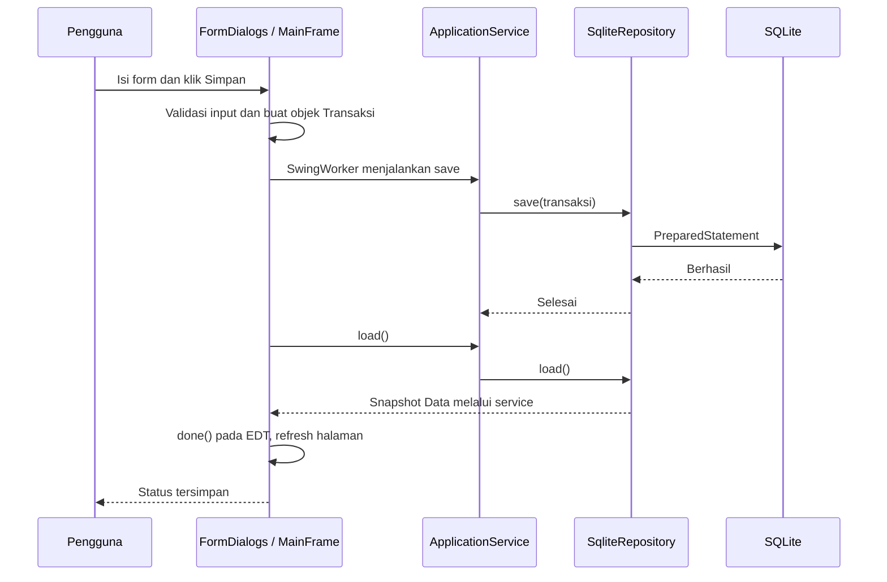

# Arsitektur dan alur kode

Struktur mengikuti bagian 6–8 modul tugas PBO (model, repository, service, view dan Main). Versi modular mempertahankan palet Ocean Blue serta fitur sebelumnya tanpa menambahkan login atau fitur yang tidak diminta.

## Pembagian tanggung jawab

| Package / class | Tanggung jawab |
|---|---|
| `Main` | Inisialisasi tema dan database, menyusun dependensi service, membuka GUI di EDT. |
| `model` | Representasi data kategori, transaksi, tugas, anggaran; `Data` adalah snapshot data immutable. |
| `repository.Database` | Lokasi file database di folder pengguna, koneksi JDBC, skema dan kategori awal. |
| `repository.Repository` | Interface operasi penyimpanan. |
| `repository.SqliteRepository` | Implementasi SQL dengan PreparedStatement dan transaksi impor atomik. |
| `service.ApplicationService` | Operasi aplikasi, akses repository, toggle status, impor/ekspor, deduplikasi pengingat, peringatan anggaran. |
| `service.Finance` | Perhitungan saldo, biaya tugas, tenggat, anggaran, grafik dan validasi. |
| `service.Csv` | Pemrosesan format CSV. |
| `view.MainFrame` | Jendela utama, menu, navigasi, status proses, SwingWorker. |
| `view.PagePanel` | Kelas abstrak dengan template method `refreshPage()` dan helper kontrol bulan/pilihan tabel. |
| `view.DashboardPanel`, `TransaksiPanel`, `TugasPanel`, `AnalisisPanel`, `AnggaranPanel` | Satu class untuk setiap halaman; mengatur layout dan menangani event pada halaman tersebut. |
| `view.FormDialogs`, `CsvActions` | Dialog formulir dan pemilihan lokasi file. |
| `view.Sidebar`, `Theme`, `Ui`, `BarChart`, `Reminder` | Komponen visual yang dapat dipakai ulang. |

## Alur menyimpan transaksi

## Penerapan PBO

- **Abstraksi:** `Repository` mendefinisikan kontrak akses data; `PagePanel` mendefinisikan siklus pembangunan halaman.
- **Inheritance:** lima panel turunan dari `PagePanel`, yang mewarisi `JPanel`.
- **Polimorfisme:** `refreshPage()` memanggil `buildContent()` dari panel yang sesuai; `ApplicationService` menerima implementasi `Repository` apa pun.
- **Enkapsulasi:** database dan service menyimpan dependensi sebagai field private; filter dan pilihan bulan dimiliki panel masing-masing. Snapshot `Data` memakai `List.copyOf` dan model data memakai field final.
- **Komposisi:** MainFrame memiliki Sidebar, panel halaman, FormDialogs, CsvActions dan ApplicationService.

## Ketentuan teknis

Semua query SQL berada dalam repository. GUI memakai layout manager, bukan koordinat absolut. Uang disimpan sebagai `long` rupiah, dan perhitungan persentase anggaran memakai BigInteger agar tidak memerlukan double untuk nilai uang. SQLite tetap menyimpan relasi transaksi terhadap tugas opsional dan data persisten di folder pengguna. Grafik dibuat sendiri lewat `paintComponent`.

## Catatan pengembangan

Refactor menggunakan kode Ocean Blue sebelumnya; struktur internal ditingkatkan, skema database dan format CSV tetap kompatibel. MainFrame tidak lagi memiliki implementasi lima halaman dan dialog formulir sekaligus. Filter masing-masing halaman tetap tersimpan ketika halaman berpindah atau tema berubah selama sesi aplikasi. Kode starter asisten lab belum tersedia, sehingga koneksi database versi ini tetap perlu dicocokkan dengan starter resmi bila diwajibkan.

Pemeriksaan offline menggunakan repository in-memory hanya untuk QA, tidak dimasukkan dalam JAR produksi. Pengujian penuh SQLite JDBC, FlatLaf, JUnit, JAR dan paket jpackage membutuhkan build Maven yang belum dapat dilakukan dalam lingkungan pembuatan.
